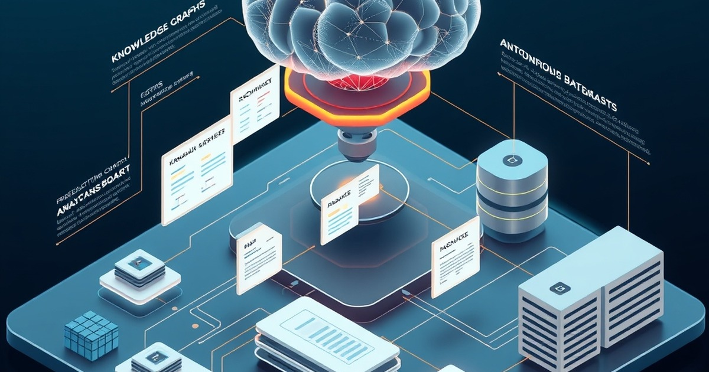

# Notion Second Brain Engine

[](https://github.com/Amz34/notion-second-brain-engine/actions/workflows/ci.yml)
[](LICENSE)
[](https://www.python.org/)

An autonomous AI second-brain orchestration engine bridging Notion databases, automated Kanban PR workflows, and analytical SQL telemetry.



## Why This Exists

Engineering teams and knowledge workers frequently maintain operational state in Notion while executing code and deployments across Git platforms and internal analytical stores. Manual synchronization across these boundaries introduces latency, missed context, and stale project tracking.

**Notion Second Brain Engine** unifies these disparate operational loops into an autonomous, event-driven agent pipeline:
- Translates Notion task boards into actionable Git branches and pull requests with clear acceptance criteria.
- Dispatches conversational SQL data scout queries into relational usage databases and formats results into native Notion callout and list blocks.
- Classifies incoming feedback and bug reports into priority tiers with automated routing rules.
- Manages Notion REST API calls with robust backoff, pagination, and 100-block payload chunking.

---

## Architecture & Core Modules

```
                        ┌───────────────────────────────┐
                        │      Notion Workspace API     │
                        └───────────────▲───────────────┘
                                        │
                         REST (JSON / Batch / Paginated)
                                        │
                        ┌───────────────▼───────────────┐
                        │         NotionClient          │
                        │    (Token Auth & Batching)    │
                        └───────┬───────────────┬───────┘
                                │               │
                ┌───────────────┴──┐         ┌──┴───────────────┐
                │                  │         │                  │
    ┌───────────▼──────────┐ ┌─────▼─────────▼──────┐ ┌─────────▼────────────┐
    │ FeedbackRouterAgent  │ │    DataScoutAgent    │ │  AgentKanbanEngine   │
    │  - Triage & Priority │ │  - SQL Query Engine  │ │  - Branch Generation │
    │  - Dynamic Rule Learn│ │  - Notion Block Gen  │ │  - PR Orchestration  │
    └──────────────────────┘ └──────────────────────┘ └──────────────────────┘
```

1. **`NotionClient` (`src/notion_client.py`)**:
   Standardized HTTP client for Notion API version `2022-06-28`. Implements token resolution from environment variables or secure configuration paths, transparent cursor-based pagination for database queries, and automatic 100-block request chunking for database page modifications.

2. **`DataScoutAgent` (`src/data_scout.py`)**:
   Executes intent-based analytical queries against local or embedded SQLite telemetry databases. Transforms tabular execution and revenue metrics into nested Notion block payloads (`callout`, `bulleted_list_item`).

3. **`AgentKanbanEngine` (`src/agent_kanban.py`)**:
   Bridges project roadmap specifications to developer environments. Deconstructs user tickets into verifiable acceptance criteria, generates standardized feature branches, and orchestrates Git / GitHub CLI workflows.

4. **`FeedbackRouterAgent` (`src/feedback_router.py`)**:
   Heuristic triage engine classifying inbound issues, feature proposals, and support tickets into categorized priorities (`P1 - High`, `P2 - Standard`). Supports dynamic rule induction during runtime.

---

## Installation & Quickstart

### Prerequisites
- Python 3.11 or higher
- Standard library dependencies (`sqlite3`, `urllib`, `unittest`, `argparse`)
- Optional: `gh` CLI for automated GitHub Pull Request workflows

### Setup
```bash
git clone https://github.com/Amz34/notion-second-brain-engine.git
cd notion-second-brain-engine
make test
```

### CLI Commands

```bash
# Verify environment prerequisites and CLI configuration
python3 -m src.cli check

# Triage incoming user feedback or production incident report
python3 -m src.cli triage "Production database connection failed with timeout crash" --json

# Query analytical telemetry and format directly as Notion blocks
python3 -m src.cli scout "top accounts" --blocks

# Generate an architectural execution plan for a roadmap ticket
python3 -m src.cli plan "Implement Notion Webhook Listener" "Add HMAC verification" "Add payload parser"
```

---

## Operational Workflows


### 1. Inbound Feedback Triage
Incoming issue descriptions are parsed by `FeedbackRouterAgent`, scoring text patterns across bug, billing, performance, and feature taxonomies:

```python
from src.feedback_router import FeedbackRouterAgent

router = FeedbackRouterAgent()
result = router.classify("Customer reported slow response times on search endpoint")
print(result)
# Output:
# {'text': 'Customer reported slow response times on search endpoint',
#  'category': 'Agent Performance',
#  'priority': 'P2 - Standard',
#  'confidence': 0.92}
```

### 2. Autonomous Analytical Telemetry to Notion
`DataScoutAgent` processes metric inquiries and yields valid Notion block structures ready for database insertion:

```python
from src.data_scout import DataScoutAgent

scout = DataScoutAgent()
query_result = scout.query("show accounts with high churn risk")
blocks = scout.generate_notion_blocks(query_result)
# Pass blocks directly to NotionClient.append_blocks(page_id, blocks)
```

---

## Testing & Quality Assurance

Run the comprehensive unit test suite:

```bash
make test
```

Or execute via the standard unittest runner:

```bash
python3 -m unittest discover -s tests -v
```

All source files are verified for compilation and syntax validity:

```bash
make lint
```

---

## Ecosystem & Related Tooling

- Part of the [Amz34](https://github.com/Amz34) open-source autonomous agent tooling family.
- Curated index: [Awesome Agent Infrastructure](https://github.com/Amz34/awesome-agent-infrastructure) — a collection of verified autonomous developer tools and workflows.

---

## License

Distributed under the [MIT License](LICENSE). Copyright (c) 2026 Amz34.
